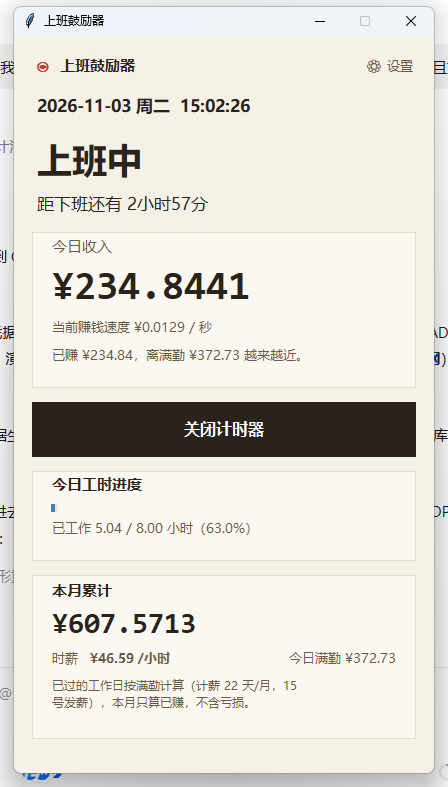
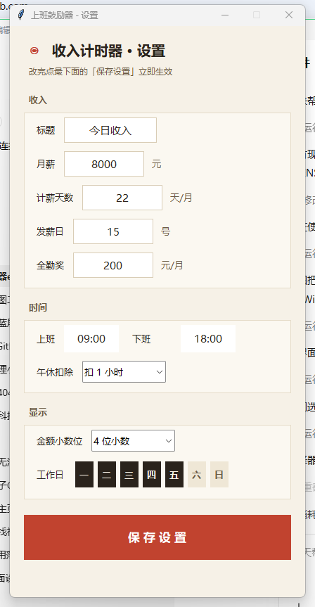
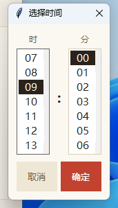

# 上班鼓励器 💰

> 一个 Windows 桌面小工具：实时计算你今天已经赚了多少钱，让你看着数字摸鱼更有动力。



## ✨ 功能特性

- **秒级计薪** —— 按你设置的月薪实时计算，金额每秒跳动（可显示 4 位小数，爽感加倍）
- **内置文案库** —— 按「今日工时进度」节点（10% / 20% / … / 90%）自动切换鼓励文案，数字全部来自实时数据
- **今日工时进度条** —— 扣除午休后按净计薪时长计算，下班那一刻正好走满 100%
- **本月累计** —— 已过工作日按满勤计算 + 今日实时已赚，附带时薪与今日满勤金额
- **完整设置页** —— 月薪、计薪天数、发薪日、全勤奖、上下班时间（时/分选择器）、午休扣除、金额小数位、工作日周几自选
- **零依赖单文件** —— 一个 11MB 的 exe，双击即用，无需安装 Python

## 🧮 计薪规则

```
日薪   =（月薪 + 全勤奖）÷ 计薪天数
时薪   = 日薪 ÷ 每日净计薪时长（上班到下班，减去午休）
每秒   = 时薪 ÷ 3600
本月累计 = 本月已过工作日 × 日薪 + 今日实时已赚
```

午休扣除从 12:00 开始计算，扣除时段内金额暂停跳动（不带薪午休，很真实）。

## 📦 下载使用

前往 [Releases](../../releases) 下载最新的 `上班鼓励器.exe`，双击运行：

1. 首次运行会弹出设置向导，填入月薪、计薪天数、上下班时间等
2. 点「保存设置」立即开始计薪
3. 之后随时点右上角 **⚙ 设置** 修改

配置保存在 `%APPDATA%\ShangBanGuLiQi\config.json`，卸载软件后删除该文件夹即可彻底清除。



上下班时间使用点选式选择器：



## 🛠 从源码运行

需要 Python 3.10+（仅标准库，无第三方依赖）：

```bash
python app.py
```

打包成 exe：

```bash
pip install pyinstaller
pyinstaller --onefile --noconsole --name 上班鼓励器 app.py
```

## 📁 项目结构

```
├── app.py          # 全部源码（单文件，含 UI / 计薪 / 文案库）
├── docs/           # 截图
└── dist/           # 构建产物（不入库）
```

## ⚠️ 说明

- 计薪基于你填写的税后月薪估算，仅供参考娱乐，不构成任何劳动法律建议 😄
- exe 未做代码签名，个别杀毒软件可能误报，添加信任即可
- Windows 10 / 11 测试通过

## 📄 License

[MIT](LICENSE)
